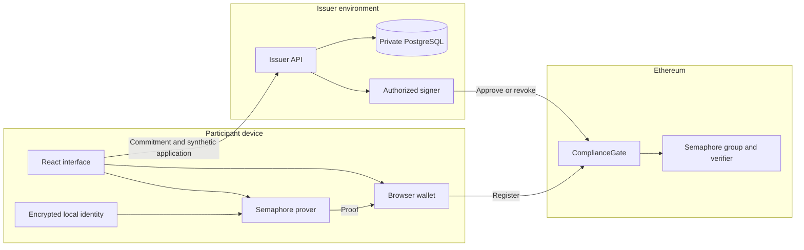
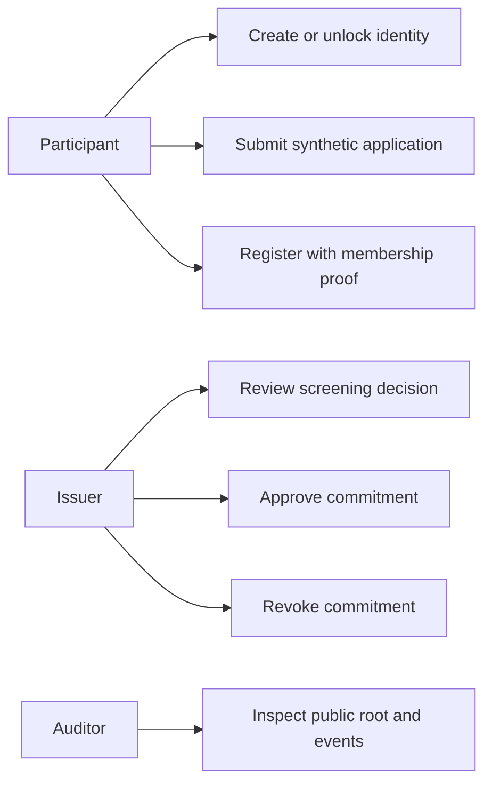
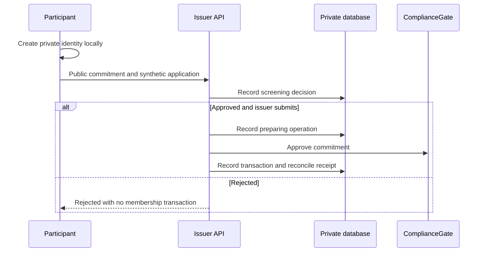
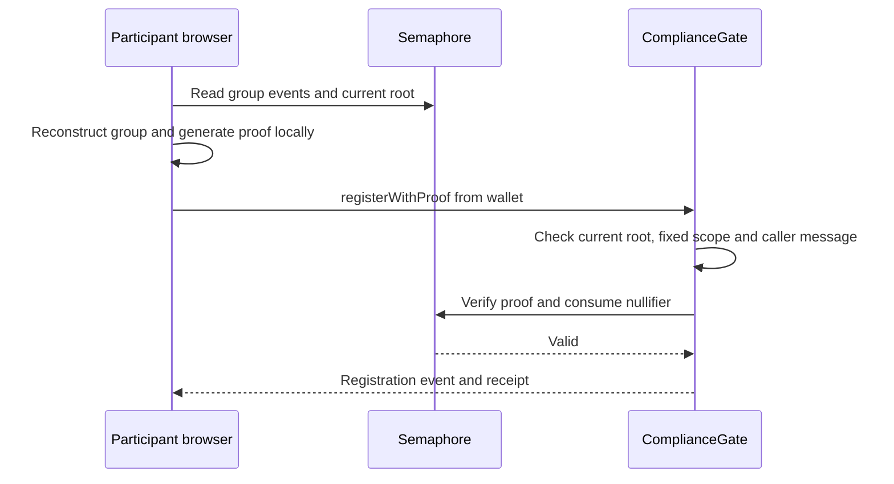
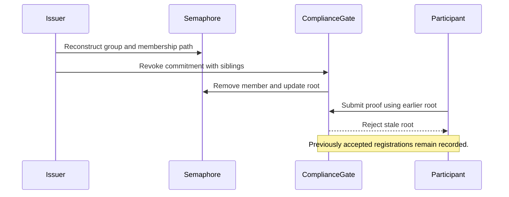

# ZK Compliance Gate architecture

This document describes the target architecture from the term-project proposal. Implementation status is tracked separately; the description is not a claim that components are complete.

## Trust boundaries

1. **Participant device:** React and TypeScript UI, wallet adapter and Semaphore V4 prover. The private identity is generated and encrypted locally. Only its public commitment is submitted to the issuer. Proofs are generated on the device.
2. **Issuer environment:** a restricted REST API, synthetic age/jurisdiction/screening decisions, PostgreSQL and an authorized transaction signer. The issuer is trusted to screen, prevent duplicate applicants and re-screen; a membership proof does not prove underlying attributes.
3. **Ethereum:** ComplianceGate manages the issuer-controlled Semaphore group and enforces proof-gated registration through Semaphore and its verifier. Public data includes commitments, roots, nullifiers, proofs, senders and events, not private screening records.

## Wallet access

A wallet signs a short-lived challenge to establish a server session. The server assigns issuer access from its configured wallet-address allowlist; other authenticated wallets are participants. The issuer sign-in wallet is separate from the backend signer that submits on-chain group updates. Session tokens expire after eight hours, and the browser keeps them only in memory. The issuer can observe the participant sign-in address and application; the membership proof does not conceal that relationship from the issuer. Public audit remains accessible without sign-in. This loopback prototype is not a production identity system.

## Flows

- Enrollment: a participant creates an identity, submits the commitment and a private reference; the issuer screens synthetic data and approves or rejects. Only an approval submits a group update.
- Registration: reconstruct the current group, generate a membership proof locally, and submit it with the participant wallet. The gate checks the current root, fixed scope and caller-bound message before calling Semaphore to verify and consume the nullifier.
- Revocation: the issuer removes the commitment using its current Merkle siblings. A new root invalidates outstanding old-root proofs, but does not undo earlier registrations. If the root changes during proving, regenerate the proof.
- Audit: inspect public roots and events without exposing screening records. Membership anonymity depends on the group: a single-member group provides no membership anonymity and very small groups provide limited privacy. It does not hide wallet addresses, timing, group updates or issuer metadata.

The action scope is derived from chain ID, gate address, group ID, policy ID and action; it must not include the changing root. The message is derived from sender and scope. A failed verification must not change registration state.

## Consistency and limitations

The issuer binds a database to the chain, gate, group and group-creation block to avoid mixing records across deployments. PostgreSQL decisions and blockchain writes are separate transactions. Track pending, confirmed and failed operations and reconcile receipts before reporting a chain update as complete. Network and signer failures must remain visible. A compromised browser or identity secret permits impersonation until revocation. No identity recovery, real document collection, commercial screening, legally certified compliance, live financial product or anonymous network transport is included.

## Local and testnet environments

The target toolchain is Solidity, Semaphore V4, React/TypeScript, a local Ethereum node, a private issuer API and PostgreSQL. Pin compatible versions and record local test, proof timing and gas evidence. Sepolia deployment and verification are separate from local validation and require explicit authorization.

## Design diagrams

### 1. Component and trust boundaries

### 2. Use cases

### 3. Issuance

### 4. Proof-gated registration

### 5. Revocation

